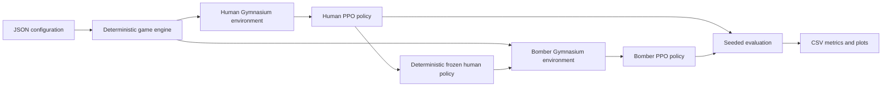

# Cooperative Reinforcement Learning: Zombie Survival

A reproducible multi-agent reinforcement-learning environment where human agents learn to escape and reusable bomber agents learn to protect them. Zombies use deterministic A* pursuit and configurable attacks; they are part of the environment rather than trained policies.

The repository focuses on the engineering around trustworthy RL experiments: deterministic resets, stable observation schemas, immutable combat events, explicit reward attribution, checkpoint compatibility, policy-vs-baseline evaluation, and regression tests that exercise real PPO updates.

## System overview



Training is intentionally staged. Humans first learn navigation and survival; bombers then train against a frozen human policy so the protection objective does not move underneath them.

## Engineering highlights

- Gymnasium-compatible human and bomber environments
- Stable-Baselines3 PPO training, checkpointing, and resume support
- Curriculum-based human training followed by cooperative bomber training
- A* zombie pursuit plus an obstacle-aware deterministic fallback controller
- Versioned, fixed-size normalized observation schema
- Event-based reward attribution for damage, kills, escapes, and deaths
- Seeded policy-vs-random comparisons using identical episode scenarios
- Headless training and evaluation with optional Pygame rendering
- CSV/TensorBoard logging and result plotting
- Deterministic tests covering environment rules and short real PPO updates

## Repository layout

```text
reinforcement_learning/
├── configs/       engine and reward configurations
├── game/          deterministic simulation, entities, maps, and combat
├── rl/            environments, policies, training, evaluation, plotting
├── tests/         environment and PPO integration regression tests
├── ui/            optional Pygame rendering
├── logs/          reproducible smoke-run reports and evaluation output
├── models/        checkpoints and metadata sidecars
└── main.py        command-line entry point
```

## Quick start

The smallest useful validation is:

```bash
python -m venv venv
source venv/bin/activate
pip install -r requirements.txt
python -m pytest -q
python -m rl.verify_training --timesteps 1024 --episodes 10
```

This confirms the simulation, Gymnasium environments, PPO training path, checkpoint loading, and seeded comparison pipeline. It is an integration check, not evidence that a policy has converged.

## Setup

```bash
python -m venv venv
source venv/bin/activate
pip install -r requirements.txt
python -m pytest -q
```

Use `venv/bin/python` instead of `python` if the environment is not activated. Rendering requires a display and Pygame; training and default evaluation are headless. TensorBoard logging is enabled when TensorBoard is installed (`pip install tensorboard`); CSV logging always works.

## Train humans, then bombers

```bash
python main.py --train-human
python main.py --train-bomber --human-model models/human/human_final_phase_3
```

Or run both stages in order:

```bash
python main.py --train-all
```

Human training defaults to 300,000 requested steps across navigation, one slower zombie, and three-zombie survival phases. Navigation with no zombies continues until escape or timeout. Bomber training defaults to 200,000 steps with five zombies and uses the saved human policy with deterministic actions. That human policy stays frozen during bomber training.

`--timesteps N` overrides the requested budget per agent, `--rollout-steps N` changes the rollout size for a new model, and `--seed N` sets the training seed. PPO rounds each phase up to complete rollouts. Custom `--config path.json` human training uses a single survival phase. Training controls entity ID 0; additional humans use the fallback during human training, and additional bombers stay idle during bomber training. Evaluation applies the learned policies to all active entities.

When no default human checkpoint exists and none is explicitly supplied, bomber training warns and uses an obstacle-aware deterministic human controller. It follows A* waypoints toward a safe zone and avoids nearby zombies. An explicitly supplied missing or incompatible checkpoint raises an error. For meaningful cooperative training, train the human policy first.

**Existing pre-v2 checkpoints in this repository are incompatible.** The observation size changed from 13/18 to 194. Retrain from scratch before evaluating or resuming. Old model files are not modified by installing this code; running the default training commands replaces their final output paths. Supply `--human-model models/v2/human --bomber-model models/v2/bomber` to save new models separately.

## Resume training

```bash
python main.py --train-human --resume models/human/human_final_phase_3 --timesteps 100000
python main.py --train-bomber --resume models/bomber/bomber_final --human-model models/human/human_final_phase_3 --timesteps 100000
```

Resume loads PPO weights, optimizer state, and timestep count. It starts fresh episodes, not an exact mid-episode replay. The original PPO rollout size is retained on resume. Final checkpoints have JSON sidecars containing schema version, configuration, human policy path and training steps; the CLI restores their engine configuration unless `--config` is supplied. Periodic checkpoints are saved under the model directory's `checkpoints/` folder; when resuming one, supply the original `--config` if it differs from defaults. Resume requires the same discount factor as reward shaping (default 0.99).

## Run trained policies and compare against random actions

```bash
python main.py --evaluate-combined --render --episodes 10
python main.py --evaluate-combined --compare --episodes 20 --seed 100 --output logs/comparison.csv
python main.py --evaluate-human --compare --episodes 20 --seed 100
python main.py --evaluate-bomber --compare --episodes 20 --seed 100
```

These run saved policies without updating weights. `--play` is explicitly random play. Learning occurs only during training: PPO collects transitions and rewards, then optimizes its policy and value losses in rollout batches. A lower loss alone does not establish better gameplay.

The comparison uses identical map/spawn seeds for each policy and the random baseline. In combined comparison, both baseline agents act randomly. In bomber-only comparison, both sides use the same frozen human policy (or the same fallback) and only bomber actions change. Use held-out seeds and sufficient episodes to judge improvement; a short smoke run is only an integration check.

Plot a comparison with `python -m rl.plot_results logs/comparison.csv --output logs/comparison.png`.

CSV evaluation reports human/bomber return, escape/death rates, survivors, zombie HP removed, kills, useful/wasted explosions, steps, and outcome. Full episodes ending at the time limit are reported as `timeout`, with Gymnasium `truncated=True`, not as wins or defeats. Training logs in `logs/human/progress.csv` and `logs/bomber/progress.csv` include every reward component, episode statistics, and PPO policy/value/entropy losses. New training invocations start new CSV logs in these locations; archive prior logs before another run if needed.

## Combat rules and configuration

Use `--config configs/survival.json` for an example with 60 damage per explosion, so a full-health zombie needs two hits. Unspecified configuration fields use defaults. Without this file, default explosion damage is 100 and zombie health is 100.

Each step resolves in this order:

1. Decrement cooldowns and age existing explosion visuals.
2. Move humans and mark humans reaching a safe zone as escaped.
3. Assign each living zombie its nearest living, unescaped human (ties use human ID), then move zombies toward attack range.
4. Move bombers or resolve explosions in stable bomber ID order.
5. Surviving zombies within attack range attack their targets if ready.
6. Update targets and decide outcomes or time-limit truncation.

All combat distances are center-to-center. A zombie threatens a human when it is alive, has that active human as its target, and is at most `threat_distance` away. This is a distance-based definition; walls do not remove threat status. An explosion is allowed only if the bomber is ready and at least one such zombie is within `explosion_radius`. Invalid attempts receive a penalty without starting cooldown or generating a blast.

A valid explosion damages every living zombie in its radius, including nearby non-threatening zombies. It never damages humans or the bomber. Damage is capped by remaining health, applied once per detonation, and attributed to the bomber responsible. Its visual lifetime cannot damage later arrivals. Only the bomber delivering the final hit earns the kill. A lethal explosion can prevent a zombie's attack in that same step. A partial-damage explosion does not stun zombies. Cooldowns advance even when an agent takes no action.

When no active humans remain, at least one escaped human means victory; otherwise defeat. If combat began with zombies, eliminating all zombies while humans remain also means victory when `end_on_zombie_clear` is enabled. Human navigation training disables that option. At least one human is required by the training environments.

## Observations and rewards

Schema v2 provides 194 normalized floats in [-1, 1]: self position/health/cooldown/blast radius, nearest safe-zone direction and distance, fixed slots for up to 8 humans, 12 zombies and 4 bombers, eight local collision-distance rays, and time remaining. Human slots include health/alive/escaped flags. Zombie slots include health, target ID, target-valid mask, threat flag and attack cooldown. Missing slots have a zero presence mask; dead entities retain their original slots. Exceeding a slot capacity raises an error. Observations never reorder engine entities. The local rays do not expose the full map, so policies must learn navigation with partial obstacle information.

`GameEngine.get_state()` returns detached state snapshots. Frozen per-step combat events carry capped damage, kills, escapes, deaths and explosion attempts. Reward code reads those events, so previous states do not change and credit is not inferred from mutable cooldowns. Environments require reset after a finished episode.

Reward weights can be overridden through `human_reward_weights` and `bomber_reward_weights` in a config JSON:

| Component | Default reward |
| --- | --- |
| Human step | -0.01 |
| Human damage / death | -1 per HP / -100 |
| Human escape | +100 |
| Human proximity danger | up to -0.05 per step |
| Bomber zombie damage / kill | +0.1 per HP / +10 |
| Extra damage / kill credit for threatening zombies | +0.1 per HP / +10 |
| Bomber penalty for human damage / death | -0.2 per HP / -50 |
| Bomber team escape reward | +20 |
| Invalid explosion attempt | -1 |
| Bomber step | -0.01 |

Human progress toward safety and bomber progress toward threats use bounded potential shaping with the same discount factor as PPO, weighted by 5 and 2 respectively. Terminal potentials are zero; time-limit truncations retain their potential for value bootstrapping. This avoids making repeated approach/retreat cycles profitable under the discounted objective. There is no positive per-step survival bonus. Human damage/death penalties and escape rewards are shared team signals for bombers; zombie damage and kill rewards are individually attributed.

## Validation

`python -m pytest -q` covers health and reward transitions, eligibility and range boundaries, cooldowns, repeated visual effects, rescue ordering, multi-bomber attribution, outcomes, navigation, observation masks, deterministic resets, and both Gymnasium environments. It also performs short real PPO updates, save/load/resume checks, verifies frozen human weights, checks logged losses, and runs reproducible policy-versus-random evaluations.

A short verification run and fixed-seed comparison are saved in `logs/smoke_v2/`. These are integration evidence, not proof of trained policy quality; see [the verification report](logs/smoke_v2/REPORT.md) for exact budgets and results. Reproduce it with `python -m rl.verify_training --timesteps 1024 --episodes 10`; smoke checkpoints use separate `models/smoke_v2/` paths.
